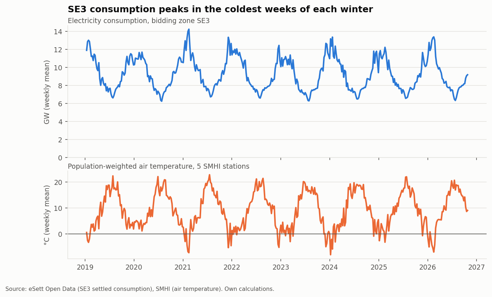

# SE3 Day-Ahead Electricity Consumption Forecast

How well can tomorrow's hourly electricity use in southern-central Sweden (bidding zone
SE3: Stockholm, Göteborg and the Mälardalen region) be predicted the day before?
This project builds and backtests forecasts on real settlement data from eSett and
weather observations from SMHI, and compares them with a simple "same hour last week" rule.

> **Status: work in progress.** Results below are placeholders until the backtest is done.



<!-- Final hero figure (forecast vs actual, cold week) replaces this in M9 -->

## Business question

A retailer responsible for balancing its customers' consumption in SE3 must bid
tomorrow's hourly consumption before noon. Forecast errors are settled as imbalance.
How much more accurate is a temperature-and-calendar model than a seasonal-naive rule,
and how reliable is it on cold peaks and holidays?

## Key findings

_To be filled with backtest results (MAE, MAPE, MASE with uncertainty)._

## Recommendation

_To be written after evaluation._

## Approach

1. Fetch settled hourly consumption (eSett) and hourly temperature at five SMHI stations.
2. Data-quality checks and reconciliation of annual totals against published statistics.
3. Seasonal-naive baselines.
4. Linear regression with heating degrees and calendar effects (also gives MW per °C).
5. Gradient boosting with quantile loss for prediction intervals.
6. Rolling-origin backtest over the last 12 months, one forecast per day at bid time.

Method choices are logged in [docs/decisions.md](docs/decisions.md); the analysis brief
is in [docs/brief.md](docs/brief.md).

## Data

All data is real and public. Nothing is synthetic except the small test fixtures in
`tests/fixtures/` (made-up values, used only to test parsers offline).

| Source | Content | Licence/terms |
|---|---|---|
| [eSett Open Data API](https://api.opendata.esett.com) | Settled consumption, MBA SE3 | eSett open data terms |
| [SMHI Open Data](https://opendata.smhi.se/apidocs/metobs/) | Hourly air temperature | CC BY 4.0 |

Data quality is documented in [docs/data_quality.md](docs/data_quality.md). Both sources
are complete for 2019-01 to 2026-10: no missing or duplicate consumption hours, and no
hour without temperature. The four-zone eSett total matches official Swedish electricity
use (excluding grid losses) to within 2.5 %. SE3 is about 63 % of national consumption.

## How to run

Requires Python 3.12.

**macOS / Linux**
```bash
python -m venv .venv && source .venv/bin/activate
pip install -r requirements.txt
python -m pytest
python scripts/run_pipeline.py fetch reconcile   # downloads data (needs internet)
python scripts/run_pipeline.py quality           # clean dataset, data-quality summary, figures
```

**Windows (PowerShell)**
```powershell
python -m venv .venv; .venv\Scripts\Activate.ps1
pip install -r requirements.txt
python -m pytest
python scripts/run_pipeline.py fetch reconcile
python scripts/run_pipeline.py quality
```

## Project structure

```
data/raw/          downloaded source data (gzip CSV) + fetch manifest
data/processed/    cleaned hourly dataset
docs/              brief, decisions log, data-quality report
reports/figures/   charts used in this README
scripts/           pipeline entry point
src/se3load/       package: API clients, calendar, metrics, models
tests/             pytest suite (offline)
```

## Limitations

_To be completed._ Known up front: observed temperature stands in for a weather
forecast; one held-out winter; settled consumption may differ from total load.

## Technology

Python 3.12 · pandas · statsmodels · scikit-learn · matplotlib · pytest · GitHub Actions

## License

Code: MIT. Data belongs to eSett Oy and SMHI.
