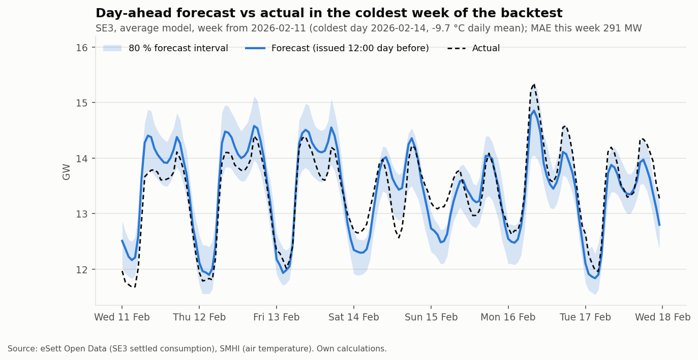
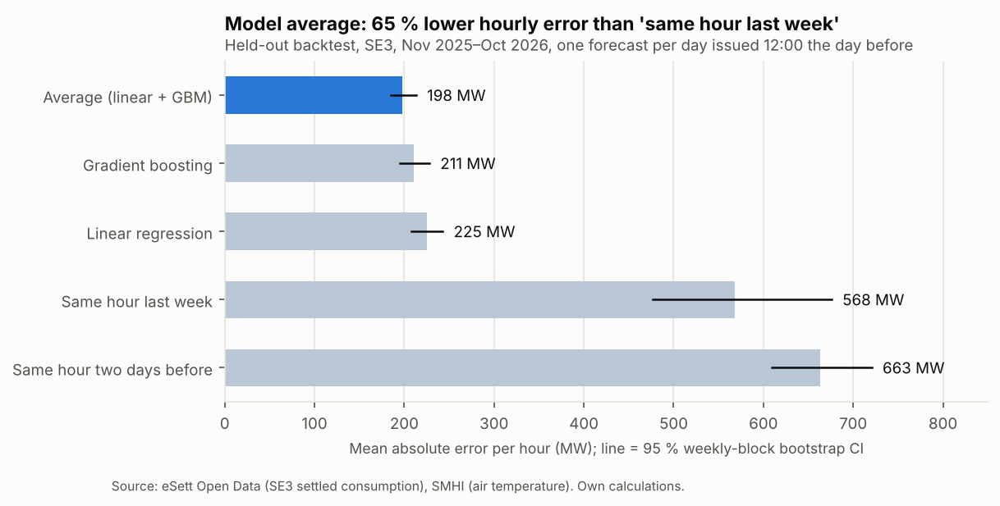
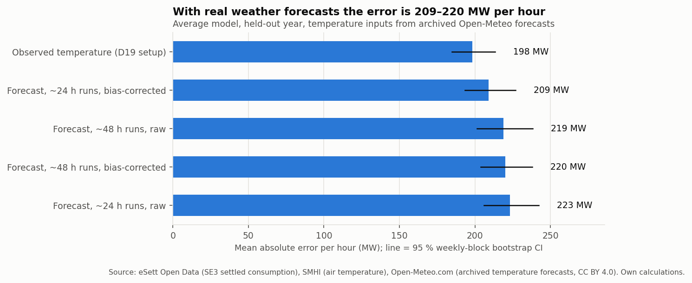
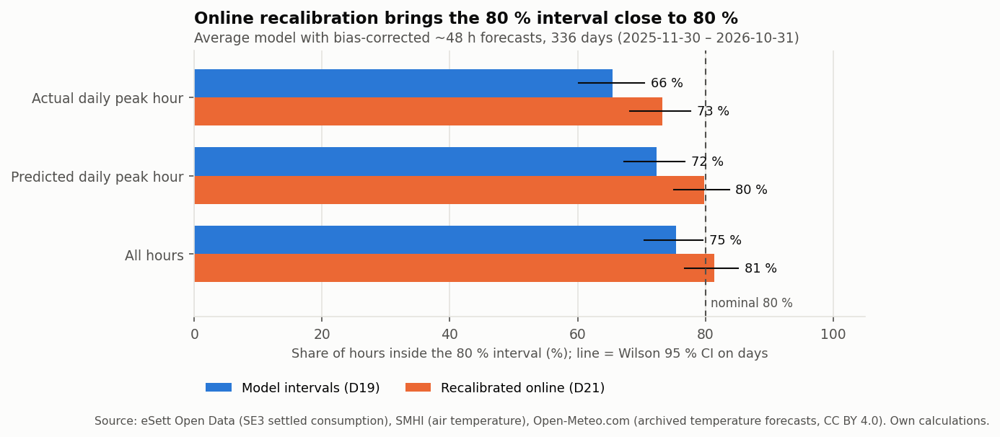
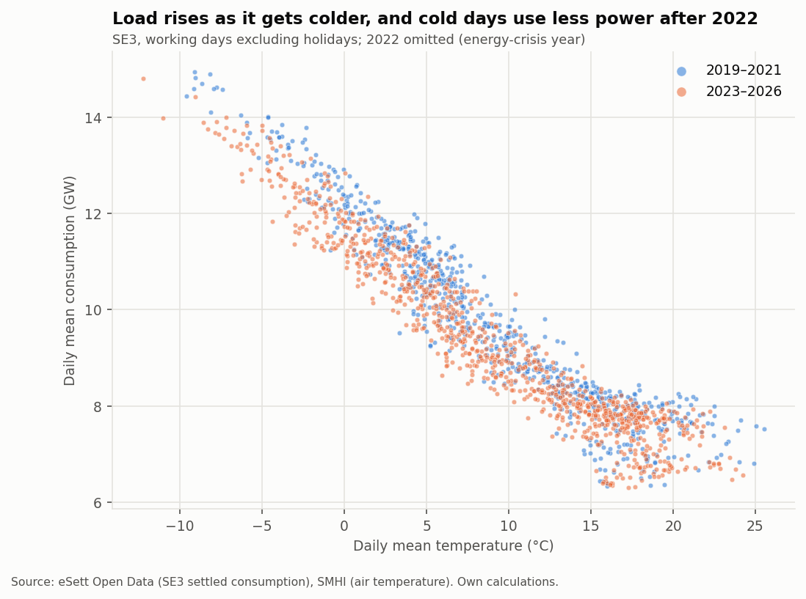

# SE3 Day-Ahead Electricity Consumption Forecast

How well can tomorrow's hourly electricity use in Sweden's largest bidding zone, SE3
(Stockholm, Göteborg and Mälardalen), be predicted at noon the day before? This project
forecasts it from temperature and the calendar, using real settlement data from eSett and
weather observations from SMHI. On a full held-out year its hourly error is about
**two-thirds lower** than that of the rule "same hour last week".



## Business question

An electricity retailer that is balance-responsible in SE3 must submit tomorrow's hourly
consumption before the day-ahead auction closes at 12:00. Every MWh of forecast error is
settled as imbalance.

- How much more accurate is a temperature-and-calendar model than a seasonal-naive rule?
- How reliable is it on the hours that matter most: cold winter peaks and holidays?
- Secondary: how many MW does SE3 consumption rise per °C of cold?

## Key findings

Held-out backtest, 1 Nov 2025 – 31 Oct 2026: 365 forecasts issued at 12:00 the day before,
8,760 hours, models refitted every 28 days on data known at the time. Pre-registered in
[docs/decisions.md](docs/decisions.md) (D19) and run once.



| Model | MAE per hour (95 % CI) | MAPE | MASE | 80 % interval coverage |
|---|---|---|---|---|
| Same hour last week (seasonal naive) | 567.9 MW (476.8–676.0) | 5.95 % | 0.90 | – |
| Linear regression | 224.8 MW (207.9–243.0) | 2.52 % | 0.357 | 77.5 % |
| Gradient boosting (quantile) | 210.7 MW (194.7–228.1) | 2.30 % | 0.334 | 67.8 % |
| **Average of the two (headline)** | **198.2 MW (184.8–213.3)** | **2.19 %** | **0.315** | **77.9 %** |

1. **The model average cuts hourly error by 65 %** compared with "same hour last week":
   −369.8 MW, 95 % CI −477.6 to −279.0 (weekly-block bootstrap), Diebold–Mariano p < 0.001.
   For the zone as a whole that is about 3.2 TWh less absolute forecast error per year
   (1.7 vs 5.0 TWh).
2. **Averaging two different models beats either one.** The average is 26.6 MW better
   than linear (CI 16.9–36.5) and 12.5 MW better than gradient boosting (CI 1.6–23.6).
   When it is colder than −5 °C, linear under-forecasts by 234 MW and gradient boosting
   over-forecasts by 151 MW, so the errors largely cancel (average bias −41 MW).
3. **Daily peaks are under-forecast, but less than it first looks.** At each day's peak
   hour the average model is 130 MW too low on average, and the 80 % interval covers only
   68.5 % of peaks. Part of that is hindsight: the actual peak hour is chosen because load
   was high. At the hour the model itself forecasts as the peak, which is what is known
   at bid time, the bias is −34 MW. The forecast *daily maximum* is still too low by 90 MW
   on average (see [Extensions](#extensions-after-the-backtest)).
4. **Cold weather drives load: about 202 MW per °C** (95 % CI 188–216) that the daily
   mean temperature falls below 15 °C, about 4.9 GWh per day per °C (2023–2025, Newey-West
   errors). That is ~11 % weaker than in 2019–2021 (227 MW/°C, CI 214–240). At the same
   temperature, SE3 has used 2–5 % less power since the 2022 energy crisis.
5. **With real archived weather forecasts the error is 209–220 MW per hour**, still
   61–63 % below the naive rule. The backtest uses observed temperature as a perfect
   forecast; feeding the models archived day-ahead temperature forecasts instead
   (Open-Meteo, ~24 h and ~48 h old runs, bias-corrected) raises MAE by 11–22 MW. The
   simulation that was planned up front (SD 1.5 °C) raises MAE by 43 MW and was too
   pessimistic: real forecast errors were 0.6–0.7 °C. This was added after the backtest
   (see [Extensions](#extensions-after-the-backtest)).

## Recommendation

- **Replace a seasonal-naive rule with the averaged model.** The gain is large, clearly
  outside the uncertainty, and holds in winter, summer, weekdays, weekends and holidays.
- **Add a peak margin learned from recent days** and recalibrate the intervals online.
  Adding the median gap between actual and forecast daily maximum over the last 90
  known days (about 64 MW) cuts the under-forecast of the daily maximum from −104 to
  −28 MW, and online recalibration brings the 80 % interval from 75 % to 81 % coverage
  (with real weather forecasts; see Extensions).
- **Plan with ≈ 200 MW of extra load per °C of colder daily mean** below 15 °C, more at
  17:00 (231 MW/°C) and 07:00 (219 MW/°C).
- **Before production:** use a bias-corrected day-ahead temperature forecast as input, and
  watch the load bias. Load in mid-2026 ran 70–240 MW above 2025 at similar temperatures, and the model
  adapts slowly (overall bias −55 MW).

## Extensions after the backtest

These two analyses were added after the pre-registered backtest (D19) had been run, to
answer its two main limitations. Both only use information available at the 12:00 bid
time, and both were specified in [docs/decisions.md](docs/decisions.md) (D20, D21)
before they were run. They are evaluated on the same held-out year, so they are **not an
untouched test**.

**Real weather forecasts (D20).** Archived day-ahead temperature forecasts for the five
stations, from Open-Meteo's Previous Runs API. Forecasts from runs made ~24 h before each
hour are slightly optimistic (some runs come after the 12:00 deadline); runs made ~48 h
before are slightly pessimistic, so the real error lies between them. A bias correction
subtracts the mean error of the same hour over the previous 28 known days.



| Temperature input | MAE per hour (95 % CI) | vs observed | vs same hour last week |
|---|---|---|---|
| Observed (D19 setup) | 198.2 MW (184.8–213.3) | – | −65.1 % |
| ~24 h runs, bias-corrected | 209.0 MW (193.3–226.9) | +10.8 MW | −63.2 % |
| ~48 h runs, bias-corrected | 220.0 MW (203.7–237.8) | +21.8 MW | −61.3 % |
| ~48 h runs, raw | 219.0 MW (201.5–238.2) | +20.8 MW | −61.4 % |

**Online recalibration and peak margin (D21).** For each day, the 80 % interval is widened
by the error quantile of the previous 90 days whose load was known at bid time
(conformalised quantile regression), separately for the forecast peak hour. A peak
margin adds the median recent gap between the actual and the forecast daily maximum.
The first 29 days have no history and are left out of both columns below.



| With ~48 h bias-corrected forecasts | Before | After |
|---|---|---|
| 80 % coverage, all hours | 75.4 % | 81.4 % |
| 80 % coverage, forecast peak hour | 72.3 % | 79.8 % |
| 80 % coverage, actual peak hour | 65.5 % | 73.2 % |
| Bias of the forecast daily maximum | −103.9 MW | −28.2 MW |
| MAE of the forecast daily maximum | 232.7 MW | 219.7 MW |

The model forecasts the right peak hour on about half of the days, so intervals at the
*actual* peak hour stay too narrow; planning against the daily maximum with a margin is
the more useful fix.

## Approach

1. **Data:** settled hourly consumption for SE3 (eSett) and hourly temperature from five
   SMHI stations, population-weighted; Swedish holidays computed in code.
2. **Data quality:** completeness, DST, units, outliers flagged rather than removed, and
   reconciliation of the four-zone total against official Swedish statistics (within
   2.5 %). See [docs/data_quality.md](docs/data_quality.md).
3. **Forecast setup that mimics the real bid:** issued 12:00 on D-1, load known only up to
   the end of D-2, lags built on local calendar dates so the DST change cannot leak data.
   Leakage is tested and re-asserted on every backtest run.
4. **Post-2022 level shift:** four ways of handling it were compared on a separate
   validation year → recency-weighted training (half-life one year).
5. **Models:** seasonal-naive baselines, Ridge regression with hour-specific heating
   slopes and split-conformal intervals, gradient boosting with quantile loss, and their
   average.
6. **Evaluation:** develop on the validation year (Nov 2024–Oct 2025). Then run the
   held-out year once with a pre-registered plan: MAE, MAPE, MASE, bootstrap CIs,
   Diebold–Mariano, segment errors, interval coverage with a day-level Wilson CI, and a
   weather-forecast-error simulation.

Every method choice, and every change made after seeing results, is logged in
[docs/decisions.md](docs/decisions.md).

## Data

All data is real and public. The only simulated parts are (a) the temperature-forecast
error simulation planned in D19, which is clearly labelled, and (b) the test fixtures.

| Source | Content | Access | Licence/terms |
|---|---|---|---|
| [eSett Open Data API](https://api.opendata.esett.com) | Settled consumption, SE3 (and SE1–SE4 for reconciliation), 2019–2026 | Open REST, no key | [CC0 1.0](https://creativecommons.org/publicdomain/zero/1.0/) |
| [SMHI Open Data](https://opendata.smhi.se/apidocs/metobs/) | Hourly air temperature, 5 stations | Open REST, no key | CC BY 4.0 |
| [Open-Meteo Previous Runs API](https://open-meteo.com/en/docs/previous-runs-api) | Archived day-ahead temperature forecasts at the 5 stations, Sep 2025 – Oct 2026 (extension D20) | Open REST, no key | [CC BY 4.0](https://open-meteo.com/en/licence), weather data by Open-Meteo.com |

Both sources are complete for Jan 2019 – Oct 2026: no missing or duplicate consumption
hours, and no hour without temperature. The four-zone eSett total matches official
Swedish electricity use excluding grid losses to within 2.5 %. SE3 is about 63 % of
national consumption.



## How to run

Requires Python 3.12. Raw data is committed, so everything except `fetch`/`reconcile`
runs offline. The full offline pipeline takes about 17 minutes on a GitHub Actions runner,
mostly the gradient-boosting backtests. A full rerun reproduced every result
file exactly ([docs/qa.md](docs/qa.md)).

**macOS / Linux**
```bash
python -m venv .venv && source .venv/bin/activate
pip install -r requirements.txt
python -m pytest
python scripts/run_pipeline.py fetch reconcile        # optional: re-download data (internet)
python scripts/run_pipeline.py quality explore select baselines regression gbm evaluate
python scripts/run_pipeline.py fetch_forecasts       # optional: re-download forecasts (internet)
python scripts/run_pipeline.py extensions             # D20/D21, about 6 minutes
```

**Windows (PowerShell)**
```powershell
python -m venv .venv; .venv\Scripts\Activate.ps1
pip install -r requirements.txt
python -m pytest
python scripts/run_pipeline.py fetch reconcile
python scripts/run_pipeline.py quality explore select baselines regression gbm evaluate
python scripts/run_pipeline.py extensions
```

Outputs: `reports/*.json` (all numbers in this README), `reports/figures/`,
`reports/predictions/`. `python scripts/check_readme.py` verifies that the key numbers
above match the JSON files.

## Project structure

```
data/raw/            downloaded eSett, SMHI and Open-Meteo data (gzip CSV) + manifests
data/reference/      official national electricity use, for reconciliation
data/processed/      clean hourly dataset (68,664 hours) with quality flags
docs/                brief, decisions log, data-quality report, QA notes
reports/             results JSON, figures, backtest predictions
scripts/             run_pipeline.py (all stages), check_readme.py
src/se3load/         API clients, calendar, quality, features, models, backtest, evaluation
tests/               pytest suite (offline)
.github/workflows/   tests on every push; pipeline on demand
```

## Limitations

- **Weather forecast:** the headline backtest uses observed temperature. Archived real
  forecasts (D20) add 11–22 MW, but they bracket the operational lead time rather than
  reproduce it, and they were evaluated on the already-used backtest year.
- **One held-out year** with one cold spell (−9.7 °C daily mean); a harsher winter would
  test the cold-extrapolation weakness of gradient boosting harder.
- **Intervals:** gradient-boosting quantiles are too narrow (68 % for a nominal 80 %), and
  the average's interval misses daily peaks (68.5 %). Online recalibration (D21) fixes the
  overall and forecast-peak coverage, not the actual-peak coverage (73 %).
- **Zone load ≠ a retailer's portfolio:** a real portfolio is smaller and noisier, so
  percentage errors would be higher. Load data up to D-2 is assumed available, which a
  retailer would get from its own metering and Svenska kraftnät rather than eSett's open
  data.
- **The temperature sensitivity is an association** conditional on calendar effects, not
  a causal estimate. The 2–5 % post-crisis drop is descriptive.
- No price, wind or solar inputs, and no behind-the-meter solar adjustment.

## Technology

Python 3.12 · pandas · scikit-learn (Ridge, HistGradientBoosting) · statsmodels (MSTL,
OLS with Newey-West) · SciPy · matplotlib · pytest · GitHub Actions

## License

Code: MIT. Data: eSett Open Data (CC0 1.0) and SMHI Open Data (CC BY 4.0, source: SMHI).
